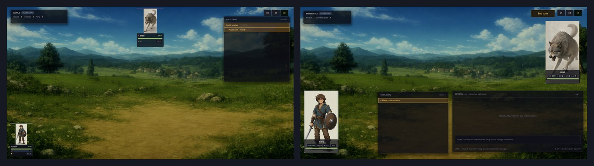
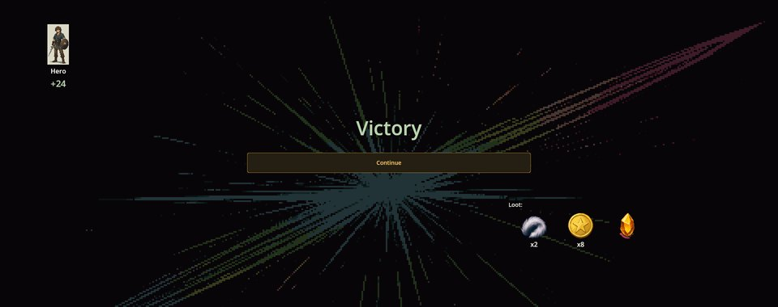
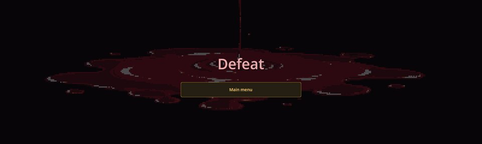

# Turn Battle Base —— 每场战斗背后的平台

Turn Battle Base 汇集了合集中所有回合制战斗的公共部分：从剧本发起战斗、以开战地点为背景的战斗场景、胜利与失败画面、经验和掉落、眩晕等状态效果，以及**战斗系统**的选择。玩家具体怎么打，平台并不决定——那是战斗系统模组的职责：**FF Battle**（指令菜单）或 **Card Battle**（把卡牌拖到目标上）。

## 两套战斗系统，一个平台

RPG Plus 里的同一场战斗——村庄中战士对狼——在两套系统下分别是这样：



战斗之外的一切都相同：村庄背景、狼的数值、右上角的 **x1 / x4 / x8** 倍速按钮（用于加快动画，选择会被记住），以及战斗结束后的流程。

游戏通过合集设置 `battle.core` 选择战斗系统；RPG Plus 使用 `ff_battle`。未设置时采用第一个已安装的系统。在合集编辑器中，这项设置名为「战斗系统」。

## 一场战斗如何进行

```text
scenario: battle.init / rpg.battle
        |
        v
battle scene: backdrop of the current place, party from the roster, enemies from their files
        |
        v
battle system (ff_battle or card_battle): player turn <-> enemy turn
        |                                          |
   all enemies defeated                      party defeated
        v                                          v
  Victory: experience, loot             Defeat: Main menu
        |
        v
  back to the scene the battle started from
```

## 胜利与失败

当最后一个敌人倒下，胜利画面会显示每位幸存队员获得的经验和掉落：



- **经验。** 每个被击败的敌人提供其 `Level × Exp`，由仍然站立的队员平分。狼为 2 级、`Exp` 12，即 **+24**。
- **掉落。** 每个被击败的敌人按其 `Loot` 列表掷点；物品直接进入背包。
- **Continue** 返回战斗开始前的场景。战斗中损失的生命不会恢复。

如果全队倒下，失败画面只提供 **Main menu**：没有经验，也没有掉落。



## 从剧本发起战斗

```scenario
action battle.init scene=town_entry enemies=wolf_1,wolf_2 quest_id=MeetingMurakamiQuest new_tag=wolf_battle
switch_scene Battle
end
```

- `enemies`——角色 id，逗号分隔；同一个 id 出现两次就是两个敌人。
- `scene`——胜利后返回的场景。
- `quest_id`、`new_tag`（可选）——把战斗绑定到任务，并给它一个标签（日志通知）。
- 战斗背景就是当时显示的背景，所以要在 `battle.init` 之前设置好。

在图块地图上，请改用 RPG 模组的 `action rpg.battle enemies=rpg_wolf win_flag=rpg_wolf_dead`：队伍会回到同一格，胜利时还会设置标记。

动作 `action battle.set_core core=card_battle` 为之后的战斗切换战斗系统。

## 数据中的敌人、掉落与状态效果

敌人就是普通角色（参见 Characters Engine）。RPG Plus 中狼的掉落：

```json
{
  "Id": "rpg_wolf",
  "Loot": [
    { "ItemId": "rpg_plus/wolf_pelt", "MinCount": 2, "MaxCount": 3, "Probability": 100 },
    { "ItemId": "money/coin", "MinCount": 8, "MaxCount": 14, "Probability": 100 }
  ]
}
```

`Probability` 是百分比；数量是 `MinCount` 到 `MaxCount` 之间（含两端）的随机数。

**状态效果**是 `status_effect` 类型的实体。平台自带眩晕——角色会跳过自己的回合：

```json
{ "Id": "effect/physics/stun", "Icon": "characters/effects/stun", "Type": "Stun", "Duration": 3, "Actions": "basic/stun" }
```

施加该效果的动作可以自行指定回合数；持续时间在每个回合开始时递减。

## 给模组作者

战斗系统是一个注册了 `IBattleCore` 的模组（自动测试还需要 `IBattleAutoPlayable`）。它的动作经由平台的执行器运行，因此像 Battle Formulas 这样的模组能一次为所有系统添加新类型的动作。代码可以通过 `BattleEndedEvent` 响应战斗结束，通过 `IWingroundListener` 响应胜利；Recruiting 就是这样邀请被击败的敌人加入队伍的。

## 出问题怎么办

1. **战斗背景为空。** `battle.init` 在场景背景设置之前就执行了。
2. **打开的战斗系统不对。** 检查游戏的 `battle.core` 设置，以及是否有剧本用 `battle.set_core` 切换过它。
3. **胜利后没有经验。** `Exp` 为 0 的敌人不给经验；倒下的队员也拿不到。
